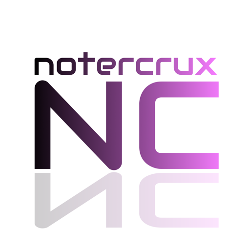
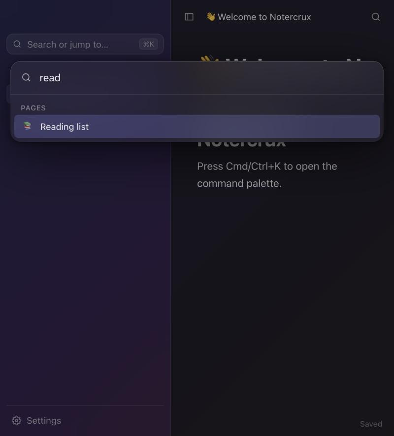
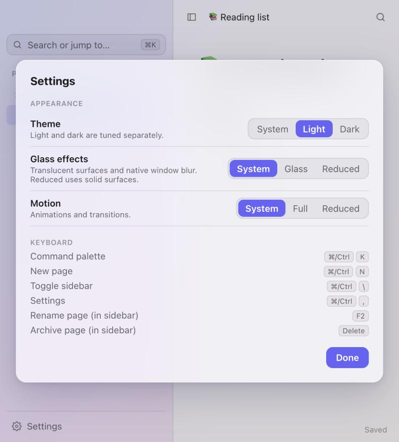

<div align="center">

<picture>
  <source media="(prefers-color-scheme: dark)" srcset="docs/assets/logo-dark.png" />
  
</picture>

# Notercrux

**A local-first, privacy-first page editor with a glass interface.**
An open-source Notion alternative for individuals — fast, light, and yours.

<sub>Pre-alpha · AGPL-3.0 · macOS & Windows first, iOS later</sub>

</div>

<br />

<p align="center">
  
  &nbsp;
  
</p>
<p align="center"><sub>Glass materials in dark and light, captured from the browser preview of the UI (the native window material is not shown).</sub></p>

## Why Notercrux

|                           |                                                                                       |
| ------------------------- | ------------------------------------------------------------------------------------- |
| **Editor first**          | Nested pages, blocks with stable identity, Markdown shortcuts, keyboard-driven.       |
| **Local-first**           | Everything lives in SQLite on your machine. Reading and editing never need a network. |
| **Private by design**     | End-to-end encrypted sync is the goal: the server must never be able to read content. |
| **Glass, with restraint** | One small material system, light/dark tuned separately, a reduced-transparency mode.  |
| **Open**                  | AGPL-3.0, documented decisions, portable data, self-hostable sync (planned).          |

Not goals: AI features, charts, or team-workspace features. See the [blueprint](Implementation/IMPLEMENTATION.md).

## Status

Notercrux is at **Phase 3 of 6: essential productivity features** (editor, links, databases, search, settings). It is not usable as a daily
notes app yet. What exists, and how well it is verified:

| Area                                                                                                                 | State                                                                       |
| -------------------------------------------------------------------------------------------------------------------- | --------------------------------------------------------------------------- |
| Desktop shell (Tauri 2): sidebar page tree, palette, menus, dialogs, settings                                        | Working in the browser preview; native build compiles                       |
| Page tree: create, nest, rename, move, duplicate, archive, restore, delete                                           | Implemented and tested in Rust; wired to the sidebar                        |
| Editor: headings, lists, tasks, quotes, callouts, code, marks, slash menu, selection toolbar, block moves, undo/redo | Working; saved as structured blocks, not HTML                               |
| Marquee selection of several blocks from the margins (copy/cut/delete/duplicate/turn into)                           | Implemented and tested; auto-scroll checked in a browser preview            |
| Block menu (click the handle), right-click menus, code language + highlighting, callout icon/colour                  | Implemented and tested; frosted look verified in a browser preview only     |
| Drag-and-drop for pages and blocks, keyboard reordering                                                              | Implemented; verified with synthetic events only (not native pointer drags) |
| Page links (`[[`), backlinks, navigation history, content search with excerpts, command palette                      | Implemented and tested                                                      |
| Databases: typed properties, relations, views with filters and sorts, record pages                                   | Implemented and tested; sync behaviour not designed yet                     |
| Settings: accent, typeface, size, page width, rebindable shortcuts                                                   | Implemented and tested                                                      |
| Export/import: Markdown (lossy, with warnings) and lossless JSON                                                     | Implemented and tested; native file dialogs not exercised yet               |
| Local persistence + full-text search (SQLite)                                                                        | Implemented and tested                                                      |
| Glass materials, light/dark, reduced transparency / motion                                                           | Implemented; **native macOS/Windows materials not yet verified**            |
| CRDT sync between two simulated devices ([ADR 0003](docs/decisions/0003-crdt-sync.md))                               | Spike, tested; **not used by the app**                                      |
| E2EE keys, recovery, device enrollment ([ADR 0004](docs/decisions/0004-e2ee-key-hierarchy.md))                       | Spike, tested; **not reviewed, not used by the app**                        |
| Sync server, attachments, iOS app, Notion import                                                                     | Not started                                                                 |

Nothing here has had a security review. Do not rely on it to protect sensitive data.

## Getting started

Requirements: [Rust](https://rustup.rs) (stable), Node 22+, [pnpm](https://pnpm.io) 10, and the
[Tauri prerequisites](https://tauri.app/start/prerequisites/) for your OS.

```bash
pnpm install
pnpm dev          # native desktop app (Tauri)
pnpm web          # UI only, in a browser, with a localStorage mock backend
pnpm test         # TypeScript and Rust tests
```

See [docs/development](docs/development/README.md) for details.

## Repository layout

```
apps/desktop        Tauri 2 + React app (src/ = UI, src-tauri/ = thin command layer)
packages/           document-model (TS mirror of the domain model + ProseMirror conversion)
crates/domain       Pages, blocks, page tree rules
crates/storage      SQLite persistence, migrations, search index
crates/crypto       Key hierarchy, encryption envelopes, recovery, enrollment (spike)
crates/sync         CRDT merging and encrypted relay protocol (spike)
docs/               Architecture, development, security, ADRs
Implementation/     The blueprint and phase descriptions
```

## Documentation

- [Architecture overview](docs/architecture/README.md)
- [Architecture decision records](docs/decisions/README.md)
- [Security model and threat model](docs/security/README.md)
- [Development guide](docs/development/README.md)
- [User guide](docs/user-guides/README.md)
- [Self-hosting](docs/self-hosting/README.md) (not available yet)

## Credits

Notercrux is made by MintFlow Technologies. Lead developer: Luca Montanari.

## Contributing & security

Read [CONTRIBUTING.md](CONTRIBUTING.md). Report vulnerabilities as described in [SECURITY.md](SECURITY.md).

## License

[AGPL-3.0-only](LICENSE).
